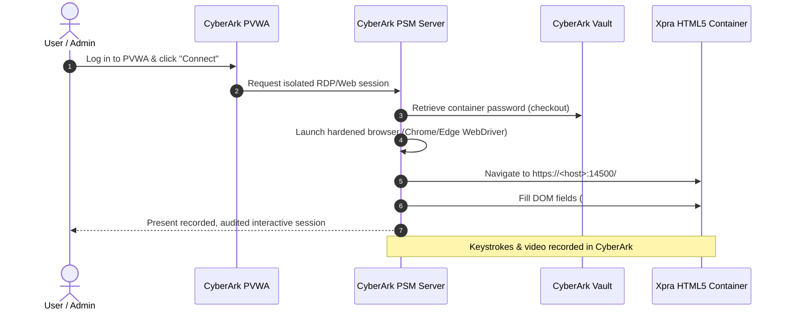
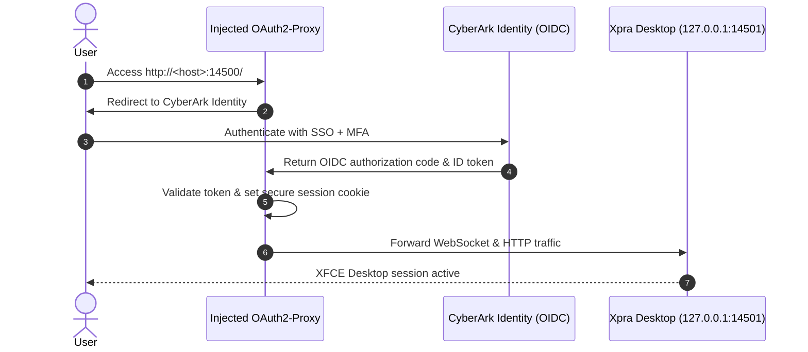

# CyberArk Integration Guide for Xpra HTML5 Desktop

This guide explains how to integrate your containerized Xpra HTML5 (XFCE4) desktop with CyberArk. Depending on your organization's deployment and security requirements, there are two primary integration patterns:

1. **[Method 1: CyberArk PAM / PSM Web Application Connector](#method-1-cyberark-pam--psm-web-application-connector)** (Recommended for Privileged Access Management, session recording, and automated vaulted credential injection).
2. **[Method 2: CyberArk Identity (SSO / OIDC Reverse Proxy)](#method-2-cyberark-identity-sso--oidc-via-oauth2-proxy)** (Recommended for general enterprise SSO, corporate MFA, and Zero Trust access).
3. **[Method 3: Dynamic Password Rotation via CyberArk CCP or Conjur](#method-3-dynamic-secret-injection-via-cyberark-ccp--conjur)** (Automating the container's `XPRA_PASSWORD`).

---

## Method 1: CyberArk PAM / PSM Web Application Connector

### Architecture



### 1. Xpra HTML5 DOM Selectors for PSM WebAppDispatcher

Xpra's HTML5 interface exposes the following DOM elements:

#### Option A: Direct Index Page (`/` or `index.html`)
- **Password Input**: `id="password"` (tag: `<input type="password" id="password" .../>`)
- **Username Input**: `id="username"` (tag: `<input type="text" id="username" .../>`)
- **Connect Button**: `id="login_connect"` (tag: `<a id="login_connect" ...>Connect</a>`)
- **Post-Login Validation Element**: `id="login-overlay"` disappears, or canvas `id="screen"` becomes visible.

#### Option B: Full Connection Form (`/connect.html`)
- **Username Input**: `id="username"`
- **Password Input**: `id="password"`
- **Connect Button**: `id="main_action_button"` (calls `doConnect()`)

### 2. CyberArk WebFormFields Configuration

In the CyberArk PVWA under:
**Administration** &rarr; **Platform Management** &rarr; **[Your Platform]** &rarr; **UI & Workflows** &rarr; **Connection Components** &rarr; **Add / Edit Web Connection Component**:

```text
username > {Username} (SearchBy=id)
password > {Password} (SearchBy=id)
login_connect > (Button) (SearchBy=id)
login-overlay > (WaitUntilNotVisible) (SearchBy=id)
```

*(If targeting `connect.html`, change `login_connect` to `main_action_button`).*

### 3. PSM Target Settings

- **ClientApp**: `Chrome` (or `Edge`)
- **ClientDispatcher**: `NAWSUniversalDispatcher.exe` (CyberArk Secure Web Application Connectors Framework)
- **Target URL**:
  - `https://{Address}:{Port}/` (Production with TLS)
  - `http://{Address}:{Port}/?insecure=true` (If testing over plain HTTP)

### 4. Account Onboarding in CyberArk PVWA

Create an account in PVWA:
- **Platform**: Web Application (or custom Xpra Desktop platform)
- **Address**: Container host IP or FQDN (e.g. `10.20.30.40`)
- **Port**: `14500`
- **Username**: `appuser` (or leave blank if Xpra only checks the password)
- **Password**: The password defined in `XPRA_PASSWORD`

---

## Method 2: CyberArk Identity (SSO / OIDC via OAuth2-Proxy)

If your organization uses **CyberArk Identity** (Workforce Password Management / IdP), you can front the container with an OIDC reverse proxy such as [`oauth2-proxy`](https://oauth2-proxy.github.io/oauth2-proxy/). Users authenticate against CyberArk Identity with corporate MFA before gaining access to Xpra.

`oauth2-proxy` is **injected directly into the container image**, giving you two deployment modes:
1. **Embedded All-in-One Mode (Recommended)**: Runs inside the same container. No extra container or network bridge required!
2. **Multi-Container Compose Stack**: Runs as a separate sidecar container.

### Architecture



### Option A: Embedded All-in-One Mode (Directly via `docker run` or `docker-compose.oauth2.yml`)

```bash
docker run -d -p 14500:14500 \
  -e ENABLE_OAUTH2_PROXY="true" \
  -e OAUTH2_PROXY_PROVIDER="oidc" \
  -e OAUTH2_PROXY_OIDC_ISSUER_URL="https://<tenant_id>.id.cyberark.cloud/oauth2/<app_id>" \
  -e OAUTH2_PROXY_CLIENT_ID="<cyberark_client_id>" \
  -e OAUTH2_PROXY_CLIENT_SECRET="<cyberark_client_secret>" \
  -e OAUTH2_PROXY_COOKIE_SECURE="false" \
  --name xpra-sso \
  xpra-html5-debian:latest
```

### Option B: Multi-Container Compose Stack (`docker-compose.cyberark.yml`)

```yaml
version: '3.8'

services:
  xpra-desktop:
    image: xpra-html5-debian:latest
    container_name: xpra-internal
    restart: unless-stopped
    shm_size: '256mb'
    environment:
      - XPRA_MODE=desktop
      - XPRA_RESOLUTION=1920x1080
      # Password can be empty if oauth2-proxy restricts access,
      # or set to a static secret shared behind the proxy.
      - XPRA_PASSWORD=
    networks:
      - internal-net

  oauth2-proxy:
    image: quay.io/oauth2-proxy/oauth2-proxy:v7.6.0
    container_name: xpra-cyberark-proxy
    ports:
      - "443:4180"
    environment:
      - OAUTH2_PROXY_HTTP_ADDRESS=0.0.0.0:4180
      - OAUTH2_PROXY_UPSTREAMS=http://xpra-internal:14500/
      - OAUTH2_PROXY_PROVIDER=oidc
      - OAUTH2_PROXY_OIDC_ISSUER_URL=https://<tenant_id>.id.cyberark.cloud/oauth2/<app_id>
      - OAUTH2_PROXY_CLIENT_ID=<cyberark_client_id>
      - OAUTH2_PROXY_CLIENT_SECRET=<cyberark_client_secret>
      - OAUTH2_PROXY_COOKIE_SECRET=s9X+7jD3W/zW9XwKqL4h6u8m3N1pQ9rS
      - OAUTH2_PROXY_COOKIE_SECURE=true
      - OAUTH2_PROXY_EMAIL_DOMAINS=yourcompany.com
      - OAUTH2_PROXY_PASS_ACCESS_TOKEN=true
      - OAUTH2_PROXY_SET_XAUTHREQUEST=true
      # Enable WebSockets for Xpra HTML5:
      - OAUTH2_PROXY_PROXY_WEBSOCKETS=true
    networks:
      - internal-net

networks:
  internal-net:
    driver: bridge
```

---

## Simulating CyberArk Identity Locally with Dex IdP

To test the entire CyberArk Identity OIDC / SSO authentication flow locally before deploying to an actual CyberArk tenant:

```bash
nerdctl compose -f docker-compose.dex.yml up -d
```

This stack orchestrates:
1. **Dex IdP Simulator** (`cyberark-dex-simulator:latest`):
   - Simulates CyberArk Identity OIDC server on `http://localhost:5556/dex`
   - Pre-configured client: `cyberark-app` (secret: `cyberark-super-secret-key-12345`)
   - Pre-configured accounts:
     - `admin@company.com` / `password`
     - `developer@company.com` / `password`
2. **Injected OAuth2-Proxy + Xpra Desktop**:
   - `oauth2-proxy` listens on `http://localhost:14500/` and transparently handles the OIDC authorization code flow.
   - Redirects unauthenticated users to Dex.
   - Upon successful login, securely proxies traffic to the internal XFCE desktop session with VoltDB CLI and MinIO client.

---

## Method 3: Dynamic Secret Injection via CyberArk CCP / Conjur

To ensure the container's password rotates automatically without rebuilding images or hardcoding passwords:

1. **CyberArk Central Credential Provider (CCP) REST API**:
   The container can query CCP at launch using mutual TLS (mTLS) or an API key:

   ```bash
   XPRA_PASSWORD=$(curl -s --cert /etc/ssl/client.crt --key /etc/ssl/client.key \
     "https://ccp.company.internal/AIMWebService/api/Accounts?AppID=XpraContainer&Safe=VDI_Accounts&Object=XpraDesktop" \
     | jq -r '.Content')
   ```

2. **CyberArk Conjur Secrets**:
   Use Conjur sidecar or Conjur native CLI/REST endpoint to fetch secrets at container startup and pass them to `entrypoint.sh`.

---

## Production Security Checklist

- [ ] **Enforce HTTPS / TLS**: Terminate TLS at a reverse proxy (Nginx, Traefik, or F5) or enable SSL directly in Xpra (`--ssl-cert=...`).
- [ ] **Disable Insecure HTTP**: Set `--ssl=on` or block direct access to port 14500 from untrusted networks.
- [ ] **Audit & Recording**: If using CyberArk PSM, verify that keystroke recording and video capture are enabled on the PSM Web Application platform.
- [ ] **Session Idle Timeout**: Set `idle-timeout` in Xpra server configuration (`/etc/xpra/xpra.conf` or entrypoint flag `--idle-timeout=1800`) to terminate inactive sessions automatically.
